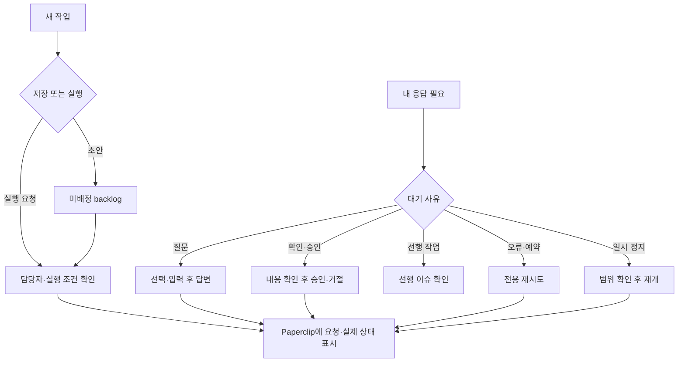

# Paseo Paperclip 작업 요청·응답 대기함

## 목표
사용자가 Paseo 패널에서 개발 작업을 요청하고, Paperclip 질문에 답하며, 확인 요청과 차단 원인을 처리한다. 화면 전달은 직접 API를 사용한다. 사용자가 실행·답변·승인·재개를 선택한 뒤에는 Paperclip 에이전트의 모델 호출이 이어질 수 있음을 표시한다.

## 요구사항
- R1: 기존 초안·조회·정지 기능을 보존한다. 새 작업은 프로젝트·제목·설명·담당자를 선택해 초안 저장 또는 실행 요청한다. 기존 미배정 backlog도 담당자 지정 후 요청할 수 있다. 성공 표시는 실행 완료가 아니라 실제 API 결과에 따른 접수·대기·진행 구분이다.
- R2: '내 응답 필요' 탭과 개수 배지를 제공한다. Paperclip attention 피드의 질문·확인·차단 항목 및 pending approval을 소속 검증 후 표시한다. 페이지 더 보기를 제공하거나 잘림을 명시한다. 표시 중 주기적 새로고침과 수동 갱신을 제공하며 앱 밖 푸시·외부 알림 전송은 추가하지 않는다. 응답 입력 중 자동 갱신으로 입력을 지우지 않는다.
- R3: ask_user_questions의 단일·다중 선택, 자유 입력, 필수 여부를 원본 계약대로 표시하고 검증한다. 질문별 ID·선택지 ID·허용된 자유 입력만 서버가 재구성한다. 이미 처리됐거나 질문 내용이 달라졌으면 제출을 거부하고 다시 확인하도록 한다. 답변 저장과 실행 전달·재개 성공을 혼동하지 않는다.
- R4: 작업 범위의 request_confirmation·request_checkbox_confirmation과 일반 업무 승인·거절을 처리한다. 검토할 제목·본문·선택지·문서가 충분히 표시된 요청만 승인할 수 있다. secretProposal·toolAction·채용·예산 등 별도 관리 권한이나 다른 도구의 실행을 포함하는 요청, 해석하지 못하는 유형은 이유와 함께 읽기 전용으로 표시한다. 요청 종류에 따라 거절·완료·후속 실행 효과를 명확히 알린다. 모든 종류를 지원한다고 주장하지 않는다.
- R5: blocked 이슈에 대해 대기 질문·승인·선행 이슈·명시적 pause·실패 실행·예약 재시도를 구별해 보여 준다. 질문/승인 카드와 선행 작업으로 이동하며 실패 실행·예약 재시도는 설치 서버의 전용 API를 사용한다. 차단 상태를 무조건 in_progress/todo로 바꾸지 않는다. cancelled 선행 작업을 완료로 간주하지 않으며 서버의 readiness를 존중한다. 추가 지시 댓글은 실행 재개 가능성을 표시하고 명시적 제출에만 보낸다.
- R6: 에이전트 재개는 명시적인 버튼과 확인 후에만 제공한다. paused 담당자를 조용히 재개하거나 여러 역할을 일괄 재개하지 않는다. 에이전트 재개가 다른 대기 업무에도 영향을 줄 수 있음을 표시한다. 작업 요청과 재개가 부분 실패하면 완료된 부분을 알려 중복 등록을 막는다.
- R7: 모든 RPC는 엄격한 입력 스키마·회사/이슈/카드/실행/에이전트 소속 확인·고정 loopback·정확한 method/path 허용·응답 제한을 유지한다. 설정·환경 변수·인증 정보·원시 로그를 전달하지 않는다. 승인 화면에서 필요한 내용이 잘리거나 해석할 수 없으면 승인 동작을 닫는다. 서버에서 제출 직전 최신 상태와 표시 내용 fingerprint를 재검증한다. 상위 API에 CAS가 없는 경로는 그 한계를 문서화한다.
- R8: mutation은 자동 재시도하지 않는다. 진행 중 중복 클릭·동시 호출을 막고, 생성은 실제 지원되는 idempotency를 사용한다. 서버에서 지원하지 않는 작업을 idempotent라고 부르지 않는다. 처리 결과가 불명확하면 재조회하도록 안내하며 원본 입력을 보존한다. 중복 생성 결과의 회사·프로젝트·담당자·상태를 확인한다.
- R9: 릴레이·인증·개인정보 설정·현재 업무는 설치와 검증 때문에 변경하지 않는다. 실제 실행/응답/승인/댓글/재개 API 검증은 모의 서버로 수행한다. 제품 코드·규칙 개정이나 다른 작업의 변경을 함께 커밋하지 않고 Git push를 하지 않는다.

## 화면 흐름

## 완료 기준
- [x] C1 (R1,R6,R8): 작업 생성·기존 초안 시작·담당자 검증·명시적 재개·중복 및 부분 실패 회귀 통과.
- [x] C2 (R2,R3): attention 목록·페이지/잘림·질문 렌더링·선택/자유 입력·응답·stale 거부·입력 보존 검증.
- [x] C3 (R4,R5): 지원하는 승인/거절·blocked 원인별 이동·전용 재시도·추가 지시, 미지원 요청의 동작 차단 검증.
- [x] C4 (R7,R8,R9): 회사 경계·조작된 ID/선택지·URL/메서드·redirect·비밀 필드·중복 호출·불명확 결과 회귀와 독립 검토 통과.
- [x] C5: 타입 검사·실제 플러그인 재적재·GET RPC·넓은/390px UI 확인. 실제 업무 mutation은 수행하지 않는다. 실물 폰·실제 실행 미검증 범위를 기록한다.
- [x] C6: 운영 안내·ADR·변경 이력·로컬 커밋·설정 보존 확인.

## 작업 배정과 검증
API 조사(interactions/execution 계약) → 구현(플러그인·mock 회귀, C1–C4) → 독립 검토(C1–C4) → 호스트 통합(재적재·GET·UI·문서·설정 보존, C5–C6) 순서로 진행한다. 쓰기 담당자는 한 명이며 루트는 설치·문서·검증을 담당한다. 기존 다른 작업의 미추적 스펙과 변경은 보존한다.

## 검증 기록
- 커밋 대상 snapshot 무결성: 52 pass·0 fail·1 skip(설치별 REGISTRY 미포함). 실제 작업 트리는 다른 작업의 기존 미추적 스펙이 MOC에 없어 52 pass·1 fail이며 해당 파일은 보존했다. `git diff --check` 통과.
- 작성자·독립 검토자의 최종 패키지 테스트 각각 36/36, 타입 검사 통과. 독립 C1–C4 검토 PASS. 기존 13개 테스트를 보존하고 조작·초안 중복 방지·실제 attention 형식 회귀를 추가했다.
- 실제 설치된 Paperclip의 GET 계약과 Paseo 0.11.2 컴파일 결과를 확인했다. 회사·보드·attention·이슈 context·에이전트 재개 조건 조회를 성공했다. 기존 질문과 차단 업무는 조회만 했으며 실행·답변·승인·재개·댓글은 실제 서버에 전송하지 않았다.
- 실제 Paseo 웹 자산을 로컬에서 제공하고 WebSocket의 Paperclip 쓰기 RPC를 가로챈 화면 검증을 사용했다. 필수 선택·자유 입력·확인 후 답변, 30초 갱신 중 입력 보존, 변경되거나 대기 목록에서 사라진 질문의 입력 보존·제출 잠금과 재확인, 체크박스·거절 사유, 예약 재시도·명시적 재개, 연속 새 작업, 제출 전 오류 수정, 통신 오류 후 중복 제출 차단을 확인했다. `rejected` 상태의 정상 거절과 `prewrite_rejected` 결과를 구분했다.
- 넓은 화면과 390px 화면에서 실제 응답함을 확인했다. 초기 실제 API의 `subject.title`·구조화된 `detail`과 모의 데이터의 차이로 빈 카드가 나타난 문제는 실제 형식 회귀와 재검증으로 수정했다. 스크립트·화면 근거는 미추적 `_workspace/paseo-paperclip-actions/`에 있다.
- Paseo 설정, Paperclip 설정·환경 파일·LaunchAgent의 SHA-256은 작업 전후 동일했다. 기존 암호화 릴레이를 보존했다. 검증 브라우저의 외부 HTTP·WebSocket 연결은 차단했으며 플러그인의 외부 전송 기능은 추가하지 않았다.
- 실물 폰·실제 릴레이 왕복·모델 실행을 동반하는 쓰기는 미검증이다. 상위 API의 CAS 부재, 알 수 없는 요청·관리자 승인 미지원, 불확실한 요청의 운영자 접수 기록 확인 제한은 운영 안내에 명시한다.
